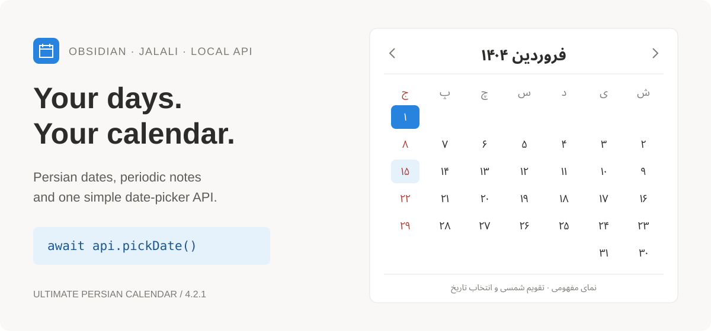
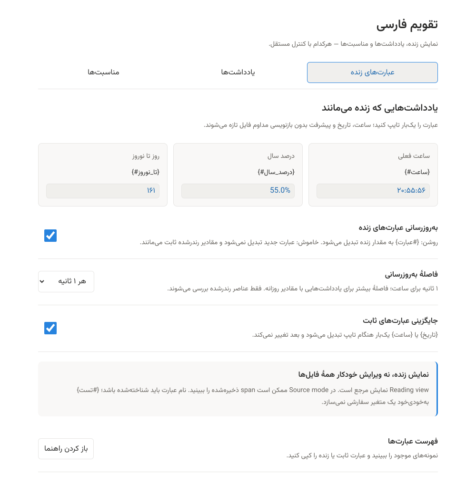

<div align="center">



# Ultimate Persian Calendar

[فارسی](README.md)

**Live notes, a Jalali calendar, and a date-picker API — in Obsidian.**

[Live expressions](docs/LIVE-EXPRESSIONS.md) · [Installation](#installation) · [API reference](docs/API.md) · [Release build](docs/RELEASING.md)


</div>

## What is this plugin?

Ultimate Persian Calendar is an Obsidian plugin with a Jalali calendar and a right-to-left interface. You can view days and events, create daily, monthly, or yearly notes, and insert dates into your text.

**Yes, it has an API:** other Obsidian plugins can open the date-picker dialog with `api.pickDate()`. This is an **internal, local API**; it does not provide a server, public HTTP endpoint, API key, or cloud service.

> The cover and live-expression image are illustrations of the behavior. The settings preview was produced from real code in a simulated host, not from a native Obsidian run. All images were rendered with Vazirmatn and their text was converted to vector paths so GitHub display does not depend on the font being installed.

## Live expressions

**Write it once; always see an updated value.** Instead of manually editing the time, date, progress percentage, or countdown to Nowruz, enter an expression using the `{#expression}` pattern:

```markdown
Current time: {#ساعت}
Today's date: {#تاریخ}
Year progress: {#پیشرفت*سال}
Days until Nowruz: {#تا*نوروز}
```


- `{ساعت}` is **static**; it records only the time at which you typed it.
- `{#ساعت}` is **live**; its displayed value changes over time in the rendered note.
- These changes affect the **display**; the Markdown file is not rewritten every second.
- In settings, you can control static/live behavior independently and set the refresh interval to **1, 5, 30, or 60 seconds**.
- `{#تست}` is only an example of the pattern: if “تست” is not a recognized expression, it will not be transformed. Creating variables or running custom code is not supported.

Reading view is the reference display. See the [complete live-expressions guide](docs/LIVE-EXPRESSIONS.md) for Source mode behavior, `span` storage, and Live Preview limitations.

## Features

| Feature | Behavior |
| --- | --- |
| Jalali calendar | Displays the month, Gregorian dates for days, today, and Fridays; navigate between months |
| Periodic notes | Create or open daily, monthly, and yearly notes; configurable names and folder |
| Events | Fetches data from two public sources; displays events and holiday indicators |
| Offline use | Calendar and date-picker work without internet; previously downloaded events remain available from cache |
| Live expressions | Refreshes note values with `{#expression}`; independent controls for static/live mode and refresh interval |
| Date-picker API | Jalali, Gregorian, ISO, timestamp, object, or custom output formats; minimum and maximum dates |

## Installation

### Build from source — current method

Requirements: **Node.js 22** and npm.

```bash
git clone --branch refactor/clean-calendar-api https://github.com/Ali-Nourix/Ultimate-Persian-Calender.git
cd Ultimate-Persian-Calender
npm ci
npm run build
```

Copy only these three files into the following folder:

```text
YourVault/.obsidian/plugins/persian-ultimate-calendar/
├── main.js
├── manifest.json
└── styles.css
```

Then reload Obsidian and enable the plugin under **Settings → Community plugins**. For manual installation, Restricted mode must be turned off; enable only code you trust.

> Do not assume that the plugin is listed in Community Plugins or that a file exists under Releases. Until a packaged version is published, use the source-build method above. The installation ID remains `persian-ultimate-calendar` to preserve existing settings and consumers.

## Usage

### Calendar and notes

1. Click the calendar icon in the ribbon, or run **“Open Persian Calendar”** from the Command Palette.
2. Click a day to display its events.
3. Double-click a day or select **Daily note** to create a note or open the existing file.
4. The month and year headings in the calendar open the monthly and yearly notes.

Default settings:

| Setting | Default | Description |
| --- | --- | --- |
| Notes folder | `Journal` | Path inside the vault |
| Daily note name | `YYYY-MM-DD` | **Jalali** date; for example, `1404-01-01.md` |
| Monthly note name | `YYYY-MM` | For example, `1404-01.md` |
| Yearly note name | `YYYY` | For example, `1404.md` |
| Show events | On | Turning this off stops fetching and displaying events |

Do not use `/` or `\` in file names; specify the path in the folder setting. An existing file is opened and its contents are not overwritten.

## New settings

Three tabs instead of one long, cluttered page:

| Tab | Controls |
| --- | --- |
| Live expressions | Value previews, independent enablement for static/live expressions, refresh interval, and expression guide |
| Notes | Path and filename validation, an example of today's filename, and reset of default templates only |
| Events | Cache status, fetch fresh data, refresh status without network access, and delete with confirmation inside Obsidian |



Save/error status is clear, changing filenames does not move previous notes, and controls work at narrow widths. Vazirmatn is fixed in the images; the actual interface follows your installed font and theme and does not download fonts from the internet.

## Date-picker API

```ts
import type { CalendarPluginApi } from "./src/api";

// Obsidian's plugin registry is internal: isolate access and check availability.
const registry = (
  app as unknown as {
    plugins?: { plugins?: Record<string, { api?: CalendarPluginApi }> };
  }
).plugins?.plugins;
const api = registry?.["persian-ultimate-calendar"]?.api;

if (api) {
  const result = await api.pickDate({
    title: "Choose a due date",
    initialDate: "1404/01/01",
    minDate: "1404/01/01",
    maxDate: "1404/12/29",
    outputFormat: "iso",
  });
  if (result) console.log(result.iso, result.jalali);
  // Cancel / Escape / close → null
}
```

A complete example consumer plugin is available at [picker-consumer.ts](docs/examples/picker-consumer.ts). The [API reference](docs/API.md) includes a copyable TypeScript contract, all output formats, safe plugin access, and cancellation behavior.

The date-picker grid is always **Jalali**; `calendar: "gregorian"` does not create a separate Gregorian view. See the [API reference](docs/API.md) for formats, inputs, bounds, and cancellation behavior.

## Events, cache, and privacy

- Sources: [pipe2time](https://github.com/hmarzban/pipe2time.ir) and [Persian Holidays API](https://github.com/BaseMax/persian-holidays-api).
- When events are enabled, the plugin requests JSON from `hmarzban.github.io` and `basemax.github.io`. Note text, filenames, and vault contents are not sent in these requests; as with any web service, providers can see the request IP address.
- The cache is stored in the plugin's own `data.json`, alongside settings and separately for each vault. The old `localStorage` cache is not migrated; a fresh fetch is performed once.
- Fetch range: the previous 12 months, the current month, and the next 24 months — 37 months in total. Duplicate requests to the same source are shared within one cycle.
- After a successful fetch, cache entries for all months are valid for one year. Old data is preserved when a fetch is incomplete, and a complete failure of both sources is not stored as a successful empty month.
- **Update cache** really fetches data again from the network. **Clear cache** deletes local data; it may be fetched again at the next startup.
- The BaseMax source mainly contains fixed Jalali events. Availability, year coverage, and the accuracy of holidays or religious events are not guaranteed; verify official decisions against a trusted calendar. Annual religious holidays are not inferred from fixed data.

## Development

```bash
npm ci
npm run dev           # watch build
npm run check         # TypeScript + unit tests + formatting
npm run build         # production main.js
```

```text
main.ts                 command registration, API, and lifecycle
src/
  api.ts                public contract and outputs
  dates.ts              date conversion, input, and formatting
  date-picker.ts        date-picker modal
  calendar-view.ts      calendar and periodic notes
  events.ts             event sources and cache
  live-expressions.ts   transformation and refresh of live values
  expressions.ts        expression evaluation
  expression-modal.ts   expression guide
  settings*.ts          settings and settings interface
tests/                  date, API, and cache tests
docs/                   API reference and images
```

The generated `main.js` is a build output and is not committed to Git. The [CI template](docs/ci.yml) and [Release action](docs/release.yml) are ready but not yet enabled; the current connection does not permit writing workflows.

To enable them, move them into `.github/workflows/` with authorized access. After checking the version, testing, and building, the Release action adds the install files and source ZIP to a **draft Release**; it does not publish publicly without review. The [step-by-step guide](docs/RELEASING.md) covers activation, the `v4.2.2` tag, and the output files. No tag or Release was created as part of these changes.

### Testing scope

Automated tests check date conversion, invalid input, picker bounds, and cache behavior. UI tests in a simulated environment do not replace running the plugin inside Obsidian itself. Before release, follow the [manual testing checklist](docs/TESTING.md) in a test vault, especially on mobile and across different themes.

## Troubleshooting

- **Plugin is not visible:** check the folder path and that all three installation files are present; then reload and enable it.
- **Events are missing:** check the events setting, internet connection, and cache update. Missing data does not necessarily mean there is no event.
- **A live expression appears as code:** switch to Reading view.
- **API is unavailable:** the plugin must be installed and enabled; check that `api` exists before calling it.
- **Date selection returns `null`:** the user may have cancelled, the plugin may have been disabled, or the input range may be invalid.

## License and attributions

The destination repository's **GPL-3.0** license is retained. The Obsidian/Dynalist sample license notice from the supplied files and the date-conversion dependency license are kept in [THIRD_PARTY_NOTICES.md](THIRD_PARTY_NOTICES.md). The project has no organizational affiliation with Obsidian or the data providers.
