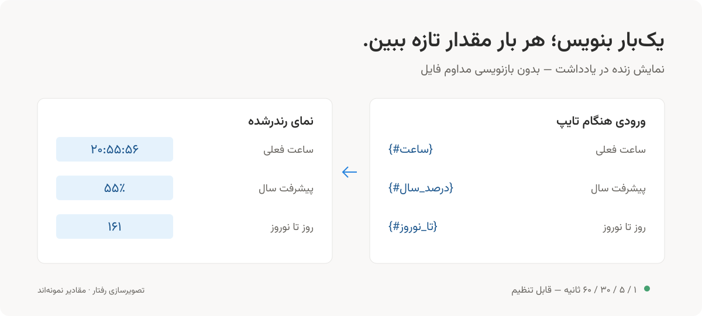

# عبارت‌های زنده در یادداشت

یک عبارت شناخته‌شده را با پیشوند `#` داخل آکولاد بنویسید؛ به‌جای یک تاریخ یا ساعت ثابت، مقدار نمایشی آن با گذشت زمان تازه می‌شود.



## مثال

هنگام تایپ در ویرایشگر:

```markdown
ساعت فعلی: {#ساعت}
تاریخ امروز: {#تاریخ}
پیشرفت سال: {#پیشرفت*سال}
روز تا نوروز: {#تا*نوروز}
```

وقتی نشانگر بلافاصله پس از `}` باشد و عبارت شناخته شود، پلاگین آن را تبدیل می‌کند. در Reading view مقدار تازه دیده می‌شود؛ مثلاً ساعت از `۲۰:۵۵:۵۶` به `۲۰:۵۵:۵۷` تغییر می‌کند. عبارت‌های متکی به رویداد فقط دادهٔ موجود در کش را منعکس می‌کنند.

## ثابت در برابر زنده

| ورودی           | رفتار                                                             |
| --------------- | ----------------------------------------------------------------- |
| `{ساعت}`        | یک‌بار به ساعت همان لحظه تبدیل می‌شود؛ ثابت می‌ماند               |
| `{#ساعت}`       | به عنصر زنده تبدیل می‌شود؛ مقدار نمایشی با زمان تازه می‌شود       |
| `{#تاریخ}`      | تاریخ نمایشی در بازشدن/به‌روزرسانی یادداشت مطابق روز جاری می‌شود  |
| `{#پیشرفت_سال}` | درصد و نوار پیشرفت به مقدار فعلی می‌رسند                          |
| `{#تا_نوروز}`   | شمارش روزهای باقی‌مانده تازه می‌شود                               |
| `{#تست}`        | اگر «تست» در فهرست عبارت‌های شناخته‌شده نباشد، دست‌نخورده می‌ماند |

`{#عبارت}` یک **الگو** است، نه موتور تعریف متغیر دلخواه، JavaScript یا فرمول سفارشی. فهرست عبارت‌های موجود از تنظیمات → عبارت‌های زنده → **باز کردن راهنما** در دسترس است.

## دقیقاً چه چیزی ذخیره می‌شود؟

تبدیل هنگام تایپ یک‌بار در متن یادداشت انجام می‌شود. مثال:

```html
<span class="persian-dynamic-tag" data-key="ساعت">۲۰:۵۵:۵۶</span>
```

کلید `data-key` پایدار می‌ماند؛ پلاگین **متن عنصر رندرشده** را تازه می‌کند. فایل Markdown هر ثانیه ذخیره یا بازنویسی نمی‌شود؛ بنابراین تاریخچهٔ فایل با تغییرات ساعت پر نمی‌شود. مقدار متنی ذخیره‌شده در Source mode ممکن است مربوط به زمان اولیه باشد و مقدار زندهٔ Reading view جدیدتر باشد.

- Reading view نمایش مرجع است.
- Live Preview به نحوهٔ نمایش HTML توسط Obsidian/تم بستگی دارد؛ پشتیبانی یکسان در همهٔ تم‌ها یا موبایل تأیید نشده است.
- یادداشت بسته هر ثانیه پردازش نمی‌شود؛ هنگام رندر مجدد مقدار فعلی محاسبه می‌شود.
- تبدیل به تایپ و محل نشانگر وابسته است. اگر نمونهٔ خام در کد یا توضیح می‌نویسید، کنترل جایگزینی عبارت‌ها را موقتاً خاموش کنید؛ این ابزار پردازشگر کامل Markdown نیست و کل Vault را بازنویسی نمی‌کند.
- غیرفعال‌کردن پلاگین، اجرای به‌روزرسانی را متوقف می‌کند؛ `span` باقی‌مانده هنوز مقدار متنی اولیهٔ ذخیره‌شده را دارد.

## کنترل در تنظیمات

در تب **عبارت‌های زنده**:

- **به‌روزرسانی عبارت‌های زنده:** کنترل تبدیل عبارت جدید و تازه‌سازی عناصر موجود.
- **فاصلهٔ به‌روزرسانی:** ۱، ۵، ۳۰ یا ۶۰ ثانیه. برای ساعت ثانیه‌ای، ۱ ثانیه را انتخاب کنید.
- **جایگزینی عبارت‌های ثابت:** مستقل از حالت زنده.
- **پیش‌نمایش:** ساعت، پیشرفت سال و شمارش تا نوروز با همان کلیدهای اصلی.

خاموش‌کردن حالت زنده عنصرهای قبلی را از فایل پاک نمی‌کند و آن‌ها را به `{#عبارت}` برنمی‌گرداند. وقتی دوباره روشن شود، نمایش زندهٔ عناصر موجود ادامه می‌یابد. دریافت مناسبت‌ها تنظیم مستقلی دارد؛ خاموش‌کردن آن، ساعت و تاریخ زنده را متوقف نمی‌کند.

فاصلهٔ تنظیم‌شده اسمی است؛ در پس‌زمینه یا هنگام توقف/کندی Obsidian، تایمر ممکن است دیرتر اجرا شود. در تازه‌سازی بعدی مقدار فعلی محاسبه می‌شود، نه یک ساعت مستقلِ تضمین‌شده.
